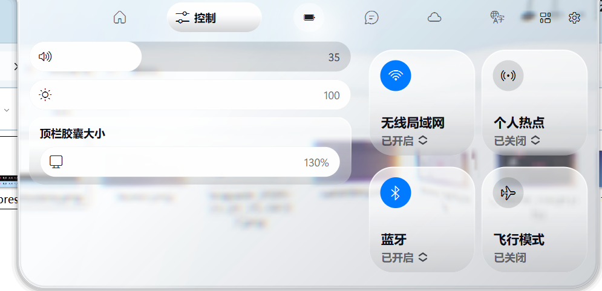
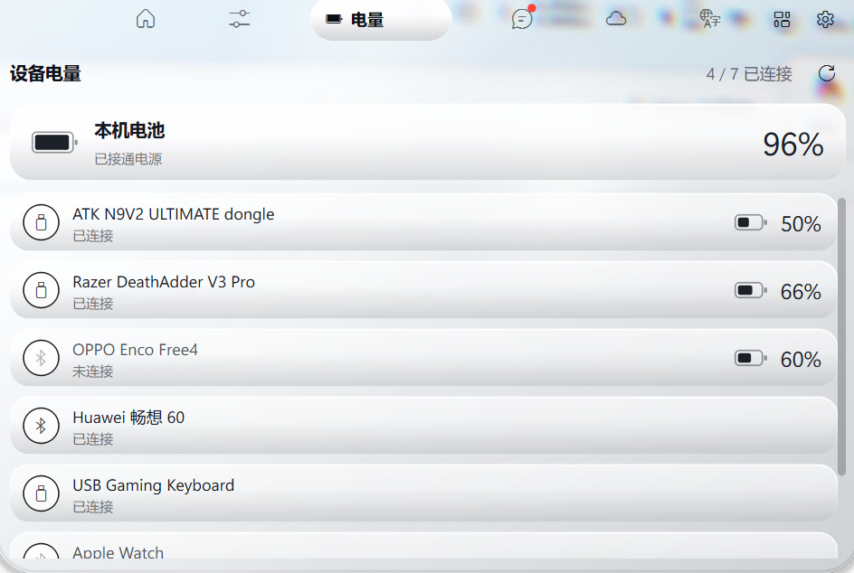

# Mybalcony · Windows 液态灵动岛

贴在屏幕边缘的液态毛玻璃胶囊，悬停弹性展开。Windows 10 / 11，Python + PySide6，全部界面自绘，不依赖网页外壳。

## 安装

1. 装 **Python 3.10+**：<https://www.python.org/downloads/windows/>（勾选 **Add python.exe to PATH**）
2. 下载项目：Releases 里的 `Mybalcony-x.y.z.zip`，或 `git clone https://github.com/Nide2003/Mybalcony.git`
3. 双击 **`setup.bat`**：自动建 `.venv` 装依赖（PyPI 连不通时自动用清华镜像）
4. 双击 **`mybalcony.vbs`** 启动

开机自启：右键灵动岛 → 开机自启。

## 能做什么

**岛本体**
- 液态玻璃外观：真折射（numpy 采样背景做边缘位移 + 色散），菜单 / 控制中心 / 磁贴 / 按钮共用同一套材质；外形与屏幕边缘以表面张力相连，拖动会拉丝、断开，松手吸附到最近的边
- 收起态：时间天气 / 小形象 / 正在播放，滚轮切换；放歌时自动显示滚动歌词（三行滚动，扫光跟着音轨走，右侧可直接播 / 暂停）
- 歌词同步：自己按帧推进，再用上报位置做最小二乘拟合校正（补偿整秒量化、±0.3s 抖动和播放器偏慢的钟）；跟不上就往大调 `media.lyric_lead`，抢拍就往小调
- 黑胶封面：圆形裁切、72°/秒旋转，暂停即停
- 可嵌进 MyDockFinder 顶栏；胶囊大小 70%～130% 可调
- 小形象：发光双眼跟随鼠标，靠近会换表情

**功能页**
- **主页**：播放控制、黑胶封面、五个玻璃按钮（保持展开 / 可穿透 / 静音 / 实时字幕 / 居中显示）、应用启动器
- **消息**：QQ / 微信 / 邮件提醒（只读通知与任务栏闪烁，不读内容）
- **股票**：A 股 / 港股 / 美股行情与分时，点 + 搜索添加
- **天气**：多城市，逐小时与 5 天预报（默认 Open-Meteo，不用 Key）
- **控制**：音量 / 亮度 / 胶囊大小滑块；iOS 风格方块磁贴（WLAN / 个人热点 / 蓝牙 / 飞行模式，检测到 Clash Verge 时多出系统代理与 TUN）。点状态行的箭头弹出二级面板：WLAN 实时扫描列表、蓝牙设备列表、热点名称密码
- **电量**：本机电池 + 蓝牙 / USB / 2.4G 设备电量，低电量提醒
- **剪贴板**：最近 10 条文字 / 图片，点击复制
- **翻译**：日译中；实时字幕（系统声音 → 日语识别 → 翻译），可点词查词、加单词本同步 Anki
- **主题**：跟随背景 / 浅色毛玻璃 / 深色毛玻璃 / 液态玻璃 / 胭脂撞色 / 晴空渐变

操作：悬停展开（停在上次看的页），离开收起；**双击**切「长关」（不再自动展开）；右键开菜单。

## 配置

`config.json` 首次启动自动生成；右键 → 编辑配置，改完右键 → 重新加载。

| 功能 | 要什么 |
| --- | --- |
| 翻译 / 实时字幕的中文 | DeepSeek Key → `translate.api_key` |
| 实时字幕的日语识别 | 不用设置，首次点「开始聆听」自动下载模型（约 630 MB，可断点续传） |
| 点词查词的词典 | `.venv\Scripts\python.exe scripts\download_models.py --dict` |
| 天气用 OpenWeather | `weather.api_key` |
| 自选股 | 股票页点 **+**，或编辑 `stocks.watchlist` |
| 歌词提前量 | `media.lyric_lead`（0～0.9，默认 0.25） |
| 同步 Anki | 装 Anki 插件 AnkiConnect |

## 效果图

控制页 · iOS 方块磁贴：

电量页 · 本机电池与蓝牙 / USB 设备：

## 说明

- 没显示正在播放 / 没歌词：网易云不用设置（读本地日志）；QQ 音乐要在设置里勾「显示系统媒体传输控制(SMTC)」；其他播放器走 SMTC，未接入的播按钮会改发键盘媒体键
- 双击 vbs 报 80070002 / 没反应：依赖没进 `.venv`，跑一次 `setup.bat`；日志在 `data\mybalcony.log`
- 某台设备读不到电量：不同品牌协议不同，读不到会在电量页写明原因，不做猜测
- 热键无效：可能被别的软件占用，改 `config.json → hotkeys`

---

实时字幕与单词本流水线移植自 [YishengTranslator-White](https://github.com/kayson-39/YishengTranslator-White)（MIT）。MIT License.
上游 [github.com/AsamiAkito/wisland](https://github.com/AsamiAkito/wisland)，MIT 许可。
